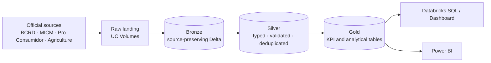

# RD Economic & Financial Intelligence Platform

An end-to-end **Data Engineering + Business Intelligence** project that will centralize economic, price and cost-of-living indicators for the **Dominican Republic** in a **Databricks Lakehouse** (Medallion Architecture), with analytics in **Databricks SQL** and **Power BI**.

**Stack:** Databricks (Free Edition) · Unity Catalog · Delta Lake · PySpark · SQL · Power BI

> **Status: in progress. Phase 2, Data Discovery & Profiling, with first Bronze ingestion in development.** Business discovery and source assessment are complete. The Unity Catalog foundation is implemented. The first Bronze pipeline (BCRD USD/DOP) is implemented and verified in development; the remaining Bronze/Silver/Gold pipelines will be built as each source's profiling, data dictionary and source-to-target mapping are reviewed.

---

## Business problem

Dominican economic data (inflation, exchange rate, fuel, consumer and agricultural prices) is spread across several institutions, each with its own format, frequency and history. That makes it hard to compare indicators over time or monitor the cost of living in one place.

## Data sources (RD-First strategy)

The platform only includes Dominican data. International data is allowed only as an explicit *external driver* of a Dominican KPI.

| Institution | Domain | Role | Profiling status |
|---|---|---|---|
| Banco Central (BCRD) | USD/DOP exchange rate | Core | Initial profiling completed |
| Banco Central (BCRD) | CPI, core CPI, CPI by group and region, family basket | Core | Initial profiling completed; detailed validation pending |
| Banco Central (BCRD) | Monetary policy rate | Core | Pending |
| MICM | Fuel prices | Core | Profiled; CSV vs. XLSX reconciliation in progress |
| Pro Consumidor | Consumer / basic basket prices | Core | Initial profiling completed; KPI feasibility in progress |
| Ministry of Agriculture | Agricultural prices (wholesale and retail) | Core | Preliminary profiling and CSV vs. XLSX reconciliation completed; quality validation open |
| U.S. EIA | WTI / Brent | External driver | Pending |

## What is built so far

**Documentation** (in [`docs/`](docs/README.md))
- [Business Requirements Document](docs/01_Business_Requirements_Document.md)
- [Project Charter](docs/02_Project_Charter.md)
- [Business Questions & KPI Catalog](docs/03_Business_Questions_KPI_Catalog.md)
- [Data Source Assessment](docs/04_Data_Source_Assessment.md)
- [Storage & Governance ADR](docs/architecture/01_Storage_and_Governance_ADR.md) (proposed)

**Data profiling** (in [`profiling/`](profiling/))
- [MICM fuel prices](profiling/micm/README.md)
- [Pro Consumidor consumer prices](profiling/proconsumidor/README.md)
- [Agricultural prices](profiling/agriculture/README.md), including CSV vs. XLSX reconciliation for wholesale and retail files.

**Databricks setup** (in [`src/setup/`](src/setup/), implemented and verified)
- Unity Catalog catalog `rd_economic_intelligence`.
- Schemas `bronze`, `silver`, `gold`, `metadata` and `quality`.
- Raw landing Volumes per source (`bcrd_raw`, `micm_raw`, `proconsumidor_raw`, `agriculture_raw`) with folders per dataset.

**Bronze ingestion** (in [`src/bronze/`](src/bronze/), development)
- [`01_BCRD_Exchange_Rates_Bronze`](src/bronze/01_BCRD_Exchange_Rates_Bronze.ipynb) loads the official BCRD daily USD/DOP file into `bronze.bcrd_exchange_rates_daily`: 1,253 rows (2021-09-20 to 2026-09-18), source values preserved, lineage metadata per row (file, sheet, source row, batch ID, ingestion timestamp), structural contract check, observational data-quality checks and idempotent re-runs. All quality checks passed on the first load.

## Target architecture

## Roadmap

| Phase | Status |
|---|---|
| Business discovery (BRD, charter, KPIs) | Complete |
| Data source assessment | Complete |
| Data discovery & profiling | In progress |
| Data dictionary & source-to-target mapping | Planned |
| Data model & data-quality contracts | Planned |
| Bronze / Silver / Gold pipelines + Jobs | In progress (first Bronze pipeline: BCRD USD/DOP) |
| Databricks SQL, dashboard and Power BI | Planned |

**Principle:** business first, data second, architecture third, implementation fourth. Pipelines are designed around validated data, not assumptions.

---

**Stanly Fernández** · [LinkedIn](https://www.linkedin.com/in/stanly-fernandez-data/) · [Portfolio](https://stanly06.github.io/) · [GitHub](https://github.com/Stanly06)
