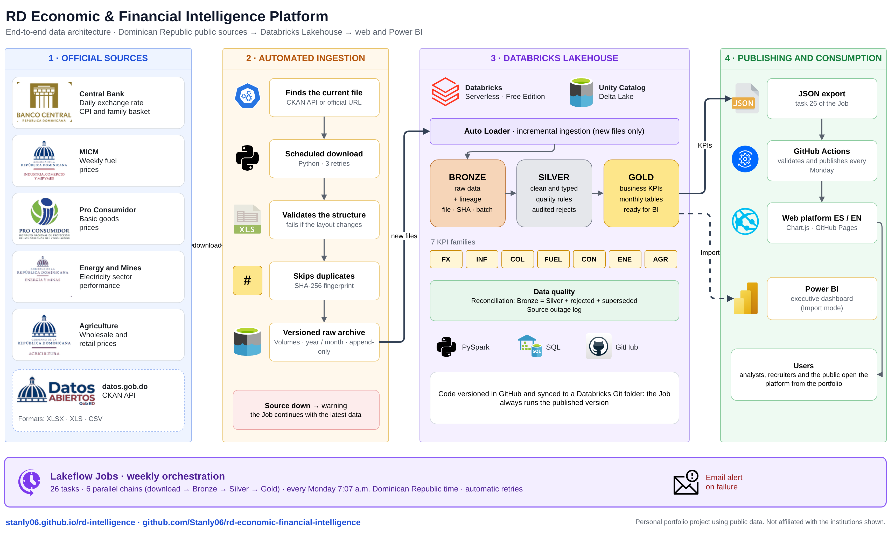

# RD Economic & Financial Intelligence Platform

An end-to-end **Data Engineering + Business Intelligence** project that centralizes economic, price and cost-of-living indicators for the **Dominican Republic** in a **Databricks Lakehouse** (Medallion Architecture), with analytics in **Databricks SQL** and **Power BI**.

**Stack:** Databricks (Free Edition) · Unity Catalog · Delta Lake · PySpark · SQL · Power BI

> **Live web platform (ES/EN): https://stanly06.github.io/rd-intelligence/** — built from the Gold tables by [`web/`](web/README.md).

> **Video walkthrough (Spanish, 28 min): https://youtu.be/-aDD3cYoCOU**: the whole platform explained stage by stage, from the official sources to the web and Power BI.

> **Status (November 2026): in operation.** All six official sources (BCRD exchange rate, BCRD CPI and family basket, MICM fuel, Pro Consumidor, MEM electricity and Ministry of Agriculture) run end to end with automatic download and incremental ingestion, orchestrated by one weekly Lakeflow Job. The Gold KPIs (FX, INF, COL, FUEL, CON, ENE and AGR) are reconciled with the values each institution publishes and feed the live web platform and a 7-page Power BI report. Next: the formal data dictionary, source-to-target mapping and data-quality documentation. **Video walkthrough (Spanish, 28 min): https://youtu.be/-aDD3cYoCOU**

---

## Business problem

Dominican economic data (inflation, exchange rate, fuel, consumer and agricultural prices) is spread across several institutions, each with its own format, frequency and history. That makes it hard to compare indicators over time or monitor the cost of living in one place.

## Data sources (RD-First strategy)

The platform only includes Dominican data. International data is allowed only as an explicit *external driver* of a Dominican KPI.

| Institution | Domain | Role | Profiling status |
|---|---|---|---|
| Banco Central (BCRD) | USD/DOP exchange rate | Core | Validated; pipelines implemented (Bronze, Silver, Gold) |
| Banco Central (BCRD) | CPI, core CPI, CPI by group and region, family basket | Core | Validated; pipelines implemented (Bronze, Silver, Gold) |
| Banco Central (BCRD) | Monetary policy rate | Core | Pending |
| MEM / SIE | Electricity: distributor prices, losses, collection and regulated tariffs | Phase 2 | Validated (MEM annex); pipelines implemented (Bronze, Silver, Gold) |
| MICM | Fuel prices | Core | Validated (XLSX authoritative); pipelines implemented (Bronze, Silver, Gold) |
| Pro Consumidor | Consumer / basic basket prices | Core | Validated for Jul–Sep 2026; pipelines implemented (Bronze, Silver, Gold). YoY, YTD, volatility and regional KPIs need more history |
| Ministry of Agriculture | Agricultural prices (wholesale and retail) | Core | Implemented: Bronze → Silver → Gold (AGR-001..005, AGR-007), automatic download from datos.gob.do |
| U.S. EIA | WTI / Brent | External driver | Pending |

## What is built so far

**Documentation** (in [`docs/`](docs/README.md))
- [Business Requirements Document](docs/01_Business_Requirements_Document.md)
- [Project Charter](docs/02_Project_Charter.md)
- [Business Questions & KPI Catalog](docs/03_Business_Questions_KPI_Catalog.md)
- [Data Source Assessment](docs/04_Data_Source_Assessment.md)
- [Storage & Governance ADR](docs/architecture/01_Storage_and_Governance_ADR.md) (proposed)

**Data profiling** (in [`profiling/`](profiling/))
- [MICM fuel prices](profiling/micm/README.md)
- [Pro Consumidor consumer prices](profiling/proconsumidor/README.md)
- [Agricultural prices](profiling/agriculture/README.md), including CSV vs. XLSX reconciliation for wholesale and retail files.

**Databricks setup** (in [`src/setup/`](src/setup/), implemented and verified)
- Unity Catalog catalog `rd_economic_intelligence`.
- Schemas `bronze`, `silver`, `gold`, `metadata` and `quality`.
- Raw landing Volumes per source (`bcrd_raw`, `micm_raw`, `proconsumidor_raw`, `mem_raw`, `agriculture_raw`) with folders per dataset. Each dataset folder is an append-only archive with one subfolder per arrival month (`<yyyy>/<mm>/`); files are never overwritten.
- **Incremental ingestion:** every Bronze notebook uses **Auto Loader** (`cloudFiles`, `binaryFile`, `trigger(availableNow=True)`) through [`src/shared/ingestion.py`](src/shared/ingestion.py). A checkpoint records which files were already seen, a file register table (`bronze.*_files`) keeps path, size, modification time and SHA-256, and each new file is captured once as a Bronze snapshot.

**Bronze ingestion** (in [`src/bronze/`](src/bronze/), development)
- [`01_BCRD_Exchange_Rates_Download`](src/bronze/01_BCRD_Exchange_Rates_Download.ipynb) downloads the official BCRD daily reference-rate workbook (`TASA_DOLAR_REFERENCIA_MC.xlsx`, stable URL, **daily since January 1991**) into the archive; it replaces the manual five-year export, which has no stable URL.
- [`01_BCRD_Exchange_Rates_Bronze`](src/bronze/01_BCRD_Exchange_Rates_Bronze.ipynb) captures both BCRD layouts as text into `bronze.bcrd_exchange_rates_daily` (8,990 rows since 1991 plus the 1,253-row five-year export), source values preserved, lineage metadata per row (file, sheet, source row, batch ID, ingestion timestamp), structural contract check, observational data-quality checks and incremental capture with Auto Loader (each archived file loaded once). All quality checks passed on the first load.
**Silver transformation** (in [`src/silver/`](src/silver/), development)
- [`01_BCRD_Exchange_Rates_Silver`](src/silver/01_BCRD_Exchange_Rates_Silver.ipynb) builds `silver.bcrd_exchange_rates_daily`: typed, validated and deduplicated USD/DOP rates (8,989 business days, 1991-01-02 to 2026-10-23; 1 source row rejected because buy > sell on 1991-01-25), enforced data-quality rules with a rejected-records log in the `quality` schema, Delta `CHECK` constraints, and Unity Catalog column documentation.
**Gold KPIs** (in [`src/gold/`](src/gold/), development)
- [`01_BCRD_Exchange_Rates_Gold`](src/gold/01_BCRD_Exchange_Rates_Gold.ipynb) calculates foreign-exchange KPIs FX-001 to FX-009 into `gold.exchange_rate_metrics` (daily) and `gold.exchange_rate_monthly_metrics` (monthly). Results reconcile with BCRD official appreciation/depreciation values on 2,506 of 2,506 comparable days (the reference values come from the five-year export).
**CPI and family basket** (development)
- [`02_BCRD_CPI_Download`](src/bronze/02_BCRD_CPI_Download.ipynb) downloads the six workbooks from their stable BCRD URLs; four are published only as legacy `.xls`, read in Bronze with `xlrd`.
- [`02_BCRD_CPI_Bronze`](src/bronze/02_BCRD_CPI_Bronze.ipynb) captures the six BCRD CPI and basket workbooks row by row as published (`bronze.bcrd_cpi_raw_rows`, one snapshot per workbook); Silver uses the newest snapshot of each dataset.
- [`02_BCRD_CPI_Silver`](src/silver/02_BCRD_CPI_Silver.ipynb) parses each presentation layout with reusable parsers in [`src/shared/`](src/shared/bcrd_cpi_parsers.py) into five tidy monthly tables (national, core, 12 expenditure groups, 4 regions, family basket). 6,504 records to September 2026, 0 rejected.
- [`02_BCRD_CPI_Gold`](src/gold/02_BCRD_CPI_Gold.ipynb) calculates inflation KPIs INF-001 to INF-006 into `gold.inflation_metrics`, reconciled with BCRD published variations (monthly 5,550/5,550; 12-month and year-to-date 808/808).
- [`03_BCRD_Cost_of_Living_Gold`](src/gold/03_BCRD_Cost_of_Living_Gold.ipynb) calculates cost-of-living KPIs COL-001 to COL-003 into `gold.cost_of_living_metrics`.

**MICM fuel prices** (development)
- [`04_MICM_Fuel_Prices_Download`](src/bronze/04_MICM_Fuel_Prices_Download.ipynb) reads the current XLSX and CSV URLs from the national open-data portal (datos.gob.do CKAN API, dataset `precios-de-los-combustibles`), validates the layout and lands new content in the archive through [`src/shared/acquisition.py`](src/shared/acquisition.py). The first run brought a newer MICM release (data to 2026-10-02).
- [`04_MICM_Fuel_Prices_Bronze`](src/bronze/04_MICM_Fuel_Prices_Bronze.ipynb) ingests incrementally with **Auto Loader** (shared helper): each XLSX and CSV archived in `micm_raw/fuel_prices/<yyyy>/<mm>/` is registered once (`bronze.micm_fuel_files`) and captured row by row as one snapshot (`bronze.micm_fuel_prices_raw`, 872 weeks each). Silver uses the newest file of each format, since each carries the full series.
- [`04_MICM_Fuel_Prices_Silver`](src/silver/04_MICM_Fuel_Prices_Silver.ipynb) resolves the price weeks with [`src/shared/micm_parsers.py`](src/shared/micm_parsers.py) and builds `silver.micm_fuel_prices_weekly` (22 fuels, 2010-01-02 to 2026-10-02, 19,206 rows). XLSX is authoritative: every CSV value equals the XLSX value rounded to whole pesos. Zero prices are treated as not published; four weeks published twice (December 2023) keep the later file row.
- [`04_MICM_Fuel_Prices_Gold`](src/gold/04_MICM_Fuel_Prices_Gold.ipynb) calculates FUEL-001 to FUEL-012 into `gold.fuel_price_metrics` (15,371 rows).

**Pro Consumidor basic-goods prices** (development)
- [`05_ProConsumidor_Prices_Download`](src/bronze/05_ProConsumidor_Prices_Download.ipynb) reads the current report URLs from datos.gob.do (dataset `precios_productos_primera_necesidad`), validates the header and lands new reports in the archive; every quarterly report keeps its own version because the source reuses the file name.
- [`05_ProConsumidor_Prices_Bronze`](src/bronze/05_ProConsumidor_Prices_Bronze.ipynb) ingests incrementally with **Auto Loader** through the shared helper [`src/shared/ingestion.py`](src/shared/ingestion.py): each quarterly workbook archived in `proconsumidor_raw/consumer_prices/<yyyy>/<mm>/` is registered once (`bronze.proconsumidor_files`) and captured as one snapshot with its report-period title (`bronze.proconsumidor_prices_raw`, 600 rows per report).
- [`05_ProConsumidor_Prices_Silver`](src/silver/05_ProConsumidor_Prices_Silver.ipynb) builds `silver.proconsumidor_prices_monthly` (570 rows, 197 products, 5 retail segments, July–September 2026) from all archived reports; each file is validated against its own report period and, where reports overlap, the newest one wins. 30 rows with years outside the report period are rejected, not corrected; product and presentation labels that differ only in capitals or spacing get one canonical label.
- [`05_ProConsumidor_Prices_Gold`](src/gold/05_ProConsumidor_Prices_Gold.ipynb) calculates CON-001 to CON-005 into `gold.consumer_price_metrics`; month-over-month change is like-for-like by retail segment.

**MEM electricity** (development)
- Source: the MEM *Informe de Desempeño de las Empresas Eléctricas Estatales* annex workbook (latest month carries the full history), downloaded automatically from the MEM website into Volume `mem_raw` by [`06_MEM_Electricity_Download`](src/bronze/06_MEM_Electricity_Download.ipynb) into an append-only archive with one folder per month (identical content is never landed twice; corrected republications are kept as new versions; the workbook structure is validated before writing).
- [`06_MEM_Electricity_Bronze`](src/bronze/06_MEM_Electricity_Bronze.ipynb) ingests incrementally with **Auto Loader** (`cloudFiles`, `binaryFile`, `trigger(availableNow=True)`): new archive files are registered once in `bronze.mem_annex_files`, and the `EDE's` and `Nuevo Regimen tarifario` sheets of each new file are captured row by row into `bronze.mem_electricity_raw_rows`, one snapshot per file. Silver uses the newest snapshot.
- [`06_MEM_Electricity_Silver`](src/silver/06_MEM_Electricity_Silver.ipynb) parses them with [`src/shared/mem_parsers.py`](src/shared/mem_parsers.py) into `silver.mem_ede_monthly` (38 indicators × Edenorte, Edesur, Edeeste and total, 2009 to July 2026; 35,446 values) and `silver.mem_tariffs_quarterly` (7 tariffs, reference and applied, 29 periods since 2020; 4,430 values).
- [`06_MEM_Electricity_Gold`](src/gold/06_MEM_Electricity_Gold.ipynb) calculates ENE-001 to ENE-009 from January 2020 into `gold.electricity_metrics`, `gold.electricity_tariff_monthly` and `gold.electricity_bts1_bill`. The average selling price reconciles with the MEM PDF report (May 2026).

**Ministry of Agriculture market prices** (development)
- [`07_MA_Agricultural_Prices_Download`](src/bronze/07_MA_Agricultural_Prices_Download.ipynb) reads the current retail (*Minorista*) and wholesale (*Mayorista*) report URLs from datos.gob.do (dataset `info`, "Informe Precios de Mercado Interdiario, 2017-2026") and lands Excel and CSV in `agriculture_raw`.
- [`07_MA_Agricultural_Prices_Bronze`](src/bronze/07_MA_Agricultural_Prices_Bronze.ipynb) ingests with Auto Loader (`bronze.ma_agri_files`); every source row is kept as a JSON text array (`bronze.ma_agri_prices_raw`: 51,559 retail and 44,533 wholesale rows per format). Retail is legacy `.xls`, read with `xlrd`.
- [`07_MA_Agricultural_Prices_Silver`](src/silver/07_MA_Agricultural_Prices_Silver.ipynb) builds `silver.ma_agri_prices_weekly` (288,618 weekly prices, August 2017 to September 2026): the seven retail market columns are unpivoted, week/month/year typos are mapped with controlled dictionaries, 24 rubro spellings map to 10 product groups, `0` and `N/D` are treated as not quoted (113,706 cells), Excel errors are rejected (258 cells). Excel and CSV agree on all 367,475 comparable price cells.
- [`07_MA_Agricultural_Prices_Gold`](src/gold/07_MA_Agricultural_Prices_Gold.ipynb) calculates AGR-001 to AGR-005 and AGR-007 into `gold.agri_price_monthly` (84,595 rows: channel × market × product × unit × month, plus an equal-weight average of the retail markets) and a product-group view `gold.agri_rubro_monthly` (2,095 rows). AGR-007 compares **markets of Gran Santo Domingo**, since the source has no regions or provinces.

**Orchestration**
- Lakeflow Job `rd_economic_medallion_pipeline` ([definition](resources/jobs/bcrd_medallion_pipeline.job.json)): six independent chains (BCRD FX, BCRD CPI, MICM fuel, Pro Consumidor, MEM electricity, Ministry of Agriculture) run in parallel, download → Bronze → Silver → Gold within each chain, plus the web export (26 tasks), with retries and failure e-mail alerts. Re-runs are idempotent.
- **Automatic refresh:** the job runs every **Monday 07:07** (America/Santo_Domingo): every chain downloads its source, ingests incrementally and rebuilds Silver and Gold; the last task (`export_web_platform_data`, runs when all chains finish) exports the validated Gold KPIs. At 09:37 a GitHub Actions workflow in the portfolio repository downloads that export through the Databricks Files API, validates it, rebuilds the [web platform](https://stanly06.github.io/rd-intelligence/) and publishes it only if the data changed. Failures are emailed (Databricks job and GitHub Actions). **Source outages are warnings, not failures:** if a publisher's site cannot be reached after 3 attempts (network or timeout, invalid TLS certificate, HTTP 5xx), the download task ends as `SOURCE_UNAVAILABLE`, the outage is logged in `quality.source_availability`, and that chain keeps its last data while the job finishes green. TLS verification is never disabled. HTTP 4xx (file moved), layout changes and failed validations still fail the job and send an e-mail. The electricity-only weekly job is paused (superseded). Power BI (Import mode) is refreshed manually.
- Lakeflow Job `rd_mem_electricity_weekly` ([definition](resources/jobs/mem_electricity_weekly.job.json)), **scheduled every Monday 07:23 (Santo Domingo)**: [`06_MEM_Electricity_Download`](src/bronze/06_MEM_Electricity_Download.ipynb) finds the newest MEM annex on the MEM website and lands it in the Volume; a condition task runs Bronze → Silver → Gold only when a new file was published. Electricity is the first source that updates without manual uploads.

**Power BI**
- [Connection, model and report design](powerbi/README.md) and [DAX measures](powerbi/measures.dax) for seven pages: Foreign Exchange, Inflation, FX vs Inflation, Cost of Living, Fuel Prices, Consumer Prices and Electricity.

## Architecture

**Video walkthrough (Spanish, 28 min):** [watch on YouTube](https://youtu.be/-aDD3cYoCOU). Chapters: [platform](https://youtu.be/-aDD3cYoCOU) · [architecture](https://youtu.be/-aDD3cYoCOU?t=45) · [official sources](https://youtu.be/-aDD3cYoCOU?t=292) · [ingestion](https://youtu.be/-aDD3cYoCOU?t=591) · [Databricks lakehouse](https://youtu.be/-aDD3cYoCOU?t=870) · [web and Power BI](https://youtu.be/-aDD3cYoCOU?t=1099) · [orchestration and failures](https://youtu.be/-aDD3cYoCOU?t=1367) · [lessons learned](https://youtu.be/-aDD3cYoCOU?t=1593)

*Versión en español: [architecture_es.png](docs/architecture/architecture_es.png). Editable sources: [English](docs/architecture/architecture_en.drawio) and [Spanish](docs/architecture/architecture_es.drawio) (open them in [diagrams.net](https://app.diagrams.net)).*

1. **Official sources.** Five Dominican institutions publish the data: the Central Bank (daily exchange rate, monthly CPI and family basket), MICM (weekly fuel prices), Pro Consumidor (basic goods prices), the Ministry of Energy and Mines (monthly distributor report) and the Ministry of Agriculture (weekly wholesale and retail prices). Most files come through the datos.gob.do CKAN API; the rest from each institution's official URL.
2. **Automated ingestion.** One download notebook per source finds the current file, downloads it with three retries, checks its structure before saving anything and skips content already archived (SHA-256). New files are written unchanged to a Unity Catalog Volume by year and month; nothing is ever overwritten or deleted. A source that is down ends as a warning and keeps its last data, while a layout change fails the task.
3. **Databricks Lakehouse.** Auto Loader picks up only new files. Bronze keeps the raw rows with file, hash and batch lineage; Silver types and validates them and sends failures to an audited rejects table; Gold holds the business KPIs in seven families (FX, INF, COL, FUEL, CON, ENE, AGR). Every load reconciles Bronze = Silver + rejected + superseded. Code is written in PySpark and SQL, versioned in GitHub and run from a Databricks Git folder.
4. **Publishing and consumption.** The last task exports the Gold KPIs to JSON. A GitHub Actions workflow downloads it, validates it and publishes the bilingual web platform (ES/EN) on GitHub Pages. The same Gold tables feed the Power BI dashboard (Import mode).

**Orchestration.** One Lakeflow Job runs 26 tasks in six parallel chains every Monday at 7:07 a.m. (America/Santo_Domingo), with retries and an email alert on failure.

## Roadmap

| Phase | Status |
|---|---|
| Business discovery (BRD, charter, KPIs) | Complete |
| Data source assessment | Complete |
| Data discovery & profiling | Complete for the six sources |
| Bronze / Silver / Gold pipelines + Jobs | Complete: automatic download, Auto Loader, one weekly Lakeflow Job (26 tasks) |
| Web platform (ES/EN) and Power BI report | Complete: live on GitHub Pages, refreshed weekly by GitHub Actions; Power BI report with 7 pages |
| Solution architecture | In progress: diagram (EN/ES) and storage & governance ADR published |
| Data dictionary, source-to-target mapping, data model, data-quality contracts | Planned (rules already enforced in the pipelines) |
| Databricks SQL analytics and dashboard | Planned |
| Project video | Complete: [full walkthrough on YouTube](https://youtu.be/-aDD3cYoCOU) |

**Principle:** business first, data second, architecture third, implementation fourth. Pipelines are designed around validated data, not assumptions.

---

**Stanly Fernández** · [LinkedIn](https://www.linkedin.com/in/stanly-fernandez-data/) · [Portfolio](https://stanly06.github.io/) · [GitHub](https://github.com/Stanly06)
