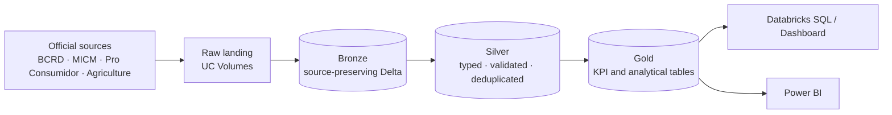

# RD Economic & Financial Intelligence Platform

An end-to-end **Data Engineering + Business Intelligence** project that will centralize economic, price and cost-of-living indicators for the **Dominican Republic** in a **Databricks Lakehouse** (Medallion Architecture), with analytics in **Databricks SQL** and **Power BI**.

**Stack:** Databricks (Free Edition) · Unity Catalog · Delta Lake · PySpark · SQL · Power BI

> **Status: in progress. All BCRD sources run end to end in development.** Business discovery and source assessment are complete. The Unity Catalog foundation is implemented. BCRD exchange rates, CPI and family basket are ingested, validated and modeled into Gold KPIs (FX, INF and COL), orchestrated by one Lakeflow Job, and reconciled with BCRD published values. MICM, Pro Consumidor and Agriculture pipelines will follow once their profiling issues are resolved.

---

## Business problem

Dominican economic data (inflation, exchange rate, fuel, consumer and agricultural prices) is spread across several institutions, each with its own format, frequency and history. That makes it hard to compare indicators over time or monitor the cost of living in one place.

## Data sources (RD-First strategy)

The platform only includes Dominican data. International data is allowed only as an explicit *external driver* of a Dominican KPI.

| Institution | Domain | Role | Profiling status |
|---|---|---|---|
| Banco Central (BCRD) | USD/DOP exchange rate | Core | Validated; pipelines implemented (Bronze, Silver, Gold) |
| Banco Central (BCRD) | CPI, core CPI, CPI by group and region, family basket | Core | Validated; pipelines implemented (Bronze, Silver, Gold) |
| Banco Central (BCRD) | Monetary policy rate | Core | Pending |
| MICM | Fuel prices | Core | Profiled; CSV vs. XLSX reconciliation in progress |
| Pro Consumidor | Consumer / basic basket prices | Core | Initial profiling completed; KPI feasibility in progress |
| Ministry of Agriculture | Agricultural prices (wholesale and retail) | Core | Preliminary profiling and CSV vs. XLSX reconciliation completed; quality validation open |
| U.S. EIA | WTI / Brent | External driver | Pending |

## What is built so far

**Documentation** (in [`docs/`](docs/README.md))
- [Business Requirements Document](docs/01_Business_Requirements_Document.md)
- [Project Charter](docs/02_Project_Charter.md)
- [Business Questions & KPI Catalog](docs/03_Business_Questions_KPI_Catalog.md)
- [Data Source Assessment](docs/04_Data_Source_Assessment.md)
- [Storage & Governance ADR](docs/architecture/01_Storage_and_Governance_ADR.md) (proposed)

**Data profiling** (in [`profiling/`](profiling/))
- [MICM fuel prices](profiling/micm/README.md)
- [Pro Consumidor consumer prices](profiling/proconsumidor/README.md)
- [Agricultural prices](profiling/agriculture/README.md), including CSV vs. XLSX reconciliation for wholesale and retail files.

**Databricks setup** (in [`src/setup/`](src/setup/), implemented and verified)
- Unity Catalog catalog `rd_economic_intelligence`.
- Schemas `bronze`, `silver`, `gold`, `metadata` and `quality`.
- Raw landing Volumes per source (`bcrd_raw`, `micm_raw`, `proconsumidor_raw`, `agriculture_raw`) with folders per dataset.

**Bronze ingestion** (in [`src/bronze/`](src/bronze/), development)
- [`01_BCRD_Exchange_Rates_Bronze`](src/bronze/01_BCRD_Exchange_Rates_Bronze.ipynb) loads the official BCRD daily USD/DOP file into `bronze.bcrd_exchange_rates_daily`: 1,253 rows (2021-09-20 to 2026-09-18), source values preserved, lineage metadata per row (file, sheet, source row, batch ID, ingestion timestamp), structural contract check, observational data-quality checks and idempotent re-runs. All quality checks passed on the first load.
**Silver transformation** (in [`src/silver/`](src/silver/), development)
- [`01_BCRD_Exchange_Rates_Silver`](src/silver/01_BCRD_Exchange_Rates_Silver.ipynb) builds `silver.bcrd_exchange_rates_daily`: typed, validated and deduplicated USD/DOP rates (1,253 business days, 0 rejected), enforced data-quality rules with a rejected-records log in the `quality` schema, Delta `CHECK` constraints, and Unity Catalog column documentation.
**Gold KPIs** (in [`src/gold/`](src/gold/), development)
- [`01_BCRD_Exchange_Rates_Gold`](src/gold/01_BCRD_Exchange_Rates_Gold.ipynb) calculates foreign-exchange KPIs FX-001 to FX-009 into `gold.exchange_rate_metrics` (daily) and `gold.exchange_rate_monthly_metrics` (monthly). Results reconcile with BCRD official appreciation/depreciation values on 2,358 of 2,358 comparable days.
**CPI and family basket** (development)
- [`02_BCRD_CPI_Bronze`](src/bronze/02_BCRD_CPI_Bronze.ipynb) captures the six BCRD CPI and basket workbooks row by row as published (`bronze.bcrd_cpi_raw_rows`).
- [`02_BCRD_CPI_Silver`](src/silver/02_BCRD_CPI_Silver.ipynb) parses each presentation layout with reusable parsers in [`src/shared/`](src/shared/bcrd_cpi_parsers.py) into five tidy monthly tables (national, core, 12 expenditure groups, 4 regions, family basket). 6,476 records, 0 rejected.
- [`02_BCRD_CPI_Gold`](src/gold/02_BCRD_CPI_Gold.ipynb) calculates inflation KPIs INF-001 to INF-006 into `gold.inflation_metrics`, reconciled with BCRD published variations (monthly 5,550/5,550; 12-month and year-to-date 808/808).
- [`03_BCRD_Cost_of_Living_Gold`](src/gold/03_BCRD_Cost_of_Living_Gold.ipynb) calculates cost-of-living KPIs COL-001 to COL-003 into `gold.cost_of_living_metrics`.

**Orchestration**
- Lakeflow Job `rd_bcrd_medallion_pipeline` ([definition](resources/jobs/bcrd_medallion_pipeline.job.json)): FX and CPI chains run in parallel (7 tasks), with retries, failure e-mail alerts and a weekday schedule (paused while source files are uploaded manually). Re-runs are idempotent.

**Power BI**
- [Connection, model and report design](powerbi/README.md) and [DAX measures](powerbi/measures.dax) for four pages: Foreign Exchange, Inflation, FX vs Inflation and Cost of Living.

## Target architecture

## Roadmap

| Phase | Status |
|---|---|
| Business discovery (BRD, charter, KPIs) | Complete |
| Data source assessment | Complete |
| Data discovery & profiling | In progress |
| Data dictionary & source-to-target mapping | Planned |
| Data model & data-quality contracts | Planned |
| Bronze / Silver / Gold pipelines + Jobs | In progress (BCRD complete: FX, CPI, basket + Job; MICM, Pro Consumidor, Agriculture pending) |
| Databricks SQL, dashboard and Power BI | In progress (Power BI model and measures defined) |

**Principle:** business first, data second, architecture third, implementation fourth. Pipelines are designed around validated data, not assumptions.

---

**Stanly Fernández** · [LinkedIn](https://www.linkedin.com/in/stanly-fernandez-data/) · [Portfolio](https://stanly06.github.io/) · [GitHub](https://github.com/Stanly06)
