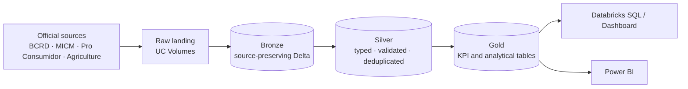

# RD Economic & Financial Intelligence Platform

An end-to-end **Data Engineering + Business Intelligence** project that will centralize economic, price and cost-of-living indicators for the **Dominican Republic** in a **Databricks Lakehouse** (Medallion Architecture), with analytics in **Databricks SQL** and **Power BI**.

**Stack:** Databricks (Free Edition) · Unity Catalog · Delta Lake · PySpark · SQL · Power BI

> **Status: in progress. BCRD, MICM, Pro Consumidor and MEM (electricity) sources run end to end in development.** Business discovery and source assessment are complete. The Unity Catalog foundation is implemented. BCRD exchange rates, CPI and family basket, MICM weekly fuel prices and Pro Consumidor basic-goods prices are ingested, validated and modeled into Gold KPIs (FX, INF, COL, FUEL and CON), and electricity (ENE) comes from the MEM monthly distributor report annex, all orchestrated by one Lakeflow Job. Agriculture is next.

---

## Business problem

Dominican economic data (inflation, exchange rate, fuel, consumer and agricultural prices) is spread across several institutions, each with its own format, frequency and history. That makes it hard to compare indicators over time or monitor the cost of living in one place.

## Data sources (RD-First strategy)

The platform only includes Dominican data. International data is allowed only as an explicit *external driver* of a Dominican KPI.

| Institution | Domain | Role | Profiling status |
|---|---|---|---|
| Banco Central (BCRD) | USD/DOP exchange rate | Core | Validated; pipelines implemented (Bronze, Silver, Gold) |
| Banco Central (BCRD) | CPI, core CPI, CPI by group and region, family basket | Core | Validated; pipelines implemented (Bronze, Silver, Gold) |
| Banco Central (BCRD) | Monetary policy rate | Core | Pending |
| MEM / SIE | Electricity: distributor prices, losses, collection and regulated tariffs | Phase 2 | Validated (MEM annex); pipelines implemented (Bronze, Silver, Gold) |
| MICM | Fuel prices | Core | Validated (XLSX authoritative); pipelines implemented (Bronze, Silver, Gold) |
| Pro Consumidor | Consumer / basic basket prices | Core | Validated for Jul–Sep 2026; pipelines implemented (Bronze, Silver, Gold). YoY, YTD, volatility and regional KPIs need more history |
| Ministry of Agriculture | Agricultural prices (wholesale and retail) | Core | Preliminary profiling and CSV vs. XLSX reconciliation completed; quality validation open |
| U.S. EIA | WTI / Brent | External driver | Pending |

## What is built so far

**Documentation** (in [`docs/`](docs/README.md))
- [Business Requirements Document](docs/01_Business_Requirements_Document.md)
- [Project Charter](docs/02_Project_Charter.md)
- [Business Questions & KPI Catalog](docs/03_Business_Questions_KPI_Catalog.md)
- [Data Source Assessment](docs/04_Data_Source_Assessment.md)
- [Storage & Governance ADR](docs/architecture/01_Storage_and_Governance_ADR.md) (proposed)

**Data profiling** (in [`profiling/`](profiling/))
- [MICM fuel prices](profiling/micm/README.md)
- [Pro Consumidor consumer prices](profiling/proconsumidor/README.md)
- [Agricultural prices](profiling/agriculture/README.md), including CSV vs. XLSX reconciliation for wholesale and retail files.

**Databricks setup** (in [`src/setup/`](src/setup/), implemented and verified)
- Unity Catalog catalog `rd_economic_intelligence`.
- Schemas `bronze`, `silver`, `gold`, `metadata` and `quality`.
- Raw landing Volumes per source (`bcrd_raw`, `micm_raw`, `proconsumidor_raw`, `agriculture_raw`) with folders per dataset.

**Bronze ingestion** (in [`src/bronze/`](src/bronze/), development)
- [`01_BCRD_Exchange_Rates_Bronze`](src/bronze/01_BCRD_Exchange_Rates_Bronze.ipynb) loads the official BCRD daily USD/DOP file into `bronze.bcrd_exchange_rates_daily`: 1,253 rows (2021-09-20 to 2026-09-18), source values preserved, lineage metadata per row (file, sheet, source row, batch ID, ingestion timestamp), structural contract check, observational data-quality checks and idempotent re-runs. All quality checks passed on the first load.
**Silver transformation** (in [`src/silver/`](src/silver/), development)
- [`01_BCRD_Exchange_Rates_Silver`](src/silver/01_BCRD_Exchange_Rates_Silver.ipynb) builds `silver.bcrd_exchange_rates_daily`: typed, validated and deduplicated USD/DOP rates (1,253 business days, 0 rejected), enforced data-quality rules with a rejected-records log in the `quality` schema, Delta `CHECK` constraints, and Unity Catalog column documentation.
**Gold KPIs** (in [`src/gold/`](src/gold/), development)
- [`01_BCRD_Exchange_Rates_Gold`](src/gold/01_BCRD_Exchange_Rates_Gold.ipynb) calculates foreign-exchange KPIs FX-001 to FX-009 into `gold.exchange_rate_metrics` (daily) and `gold.exchange_rate_monthly_metrics` (monthly). Results reconcile with BCRD official appreciation/depreciation values on 2,358 of 2,358 comparable days.
**CPI and family basket** (development)
- [`02_BCRD_CPI_Bronze`](src/bronze/02_BCRD_CPI_Bronze.ipynb) captures the six BCRD CPI and basket workbooks row by row as published (`bronze.bcrd_cpi_raw_rows`).
- [`02_BCRD_CPI_Silver`](src/silver/02_BCRD_CPI_Silver.ipynb) parses each presentation layout with reusable parsers in [`src/shared/`](src/shared/bcrd_cpi_parsers.py) into five tidy monthly tables (national, core, 12 expenditure groups, 4 regions, family basket). 6,476 records, 0 rejected.
- [`02_BCRD_CPI_Gold`](src/gold/02_BCRD_CPI_Gold.ipynb) calculates inflation KPIs INF-001 to INF-006 into `gold.inflation_metrics`, reconciled with BCRD published variations (monthly 5,550/5,550; 12-month and year-to-date 808/808).
- [`03_BCRD_Cost_of_Living_Gold`](src/gold/03_BCRD_Cost_of_Living_Gold.ipynb) calculates cost-of-living KPIs COL-001 to COL-003 into `gold.cost_of_living_metrics`.

**MICM fuel prices** (development)
- [`04_MICM_Fuel_Prices_Bronze`](src/bronze/04_MICM_Fuel_Prices_Bronze.ipynb) captures the weekly XLSX and CSV row by row (`bronze.micm_fuel_prices_raw`, 872 weeks each).
- [`04_MICM_Fuel_Prices_Silver`](src/silver/04_MICM_Fuel_Prices_Silver.ipynb) resolves the price weeks with [`src/shared/micm_parsers.py`](src/shared/micm_parsers.py) and builds `silver.micm_fuel_prices_weekly` (22 fuels, 2010-01-02 to 2026-08-28, 19,096 rows). XLSX is authoritative: every CSV value equals the XLSX value rounded to whole pesos. Zero prices are treated as not published; four weeks published twice (December 2023) keep the later file row.
- [`04_MICM_Fuel_Prices_Gold`](src/gold/04_MICM_Fuel_Prices_Gold.ipynb) calculates FUEL-001 to FUEL-012 into `gold.fuel_price_metrics` (15,296 rows).

**Pro Consumidor basic-goods prices** (development)
- [`05_ProConsumidor_Prices_Bronze`](src/bronze/05_ProConsumidor_Prices_Bronze.ipynb) captures the XLSX and its report-period title (`bronze.proconsumidor_prices_raw`, 600 rows).
- [`05_ProConsumidor_Prices_Silver`](src/silver/05_ProConsumidor_Prices_Silver.ipynb) builds `silver.proconsumidor_prices_monthly` (570 rows, 197 products, 5 retail segments, July–September 2026). 30 rows with years outside the report period are rejected, not corrected; product and presentation labels that differ only in capitals or spacing get one canonical label.
- [`05_ProConsumidor_Prices_Gold`](src/gold/05_ProConsumidor_Prices_Gold.ipynb) calculates CON-001 to CON-005 into `gold.consumer_price_metrics`; month-over-month change is like-for-like by retail segment.

**MEM electricity** (development)
- Source: the MEM *Informe de Desempeño de las Empresas Eléctricas Estatales* annex workbook (latest month carries the full history), downloaded automatically from the MEM website into Volume `mem_raw` by [`06_MEM_Electricity_Download`](src/bronze/06_MEM_Electricity_Download.ipynb) (skips files already landed, validates the workbook structure before writing).
- [`06_MEM_Electricity_Bronze`](src/bronze/06_MEM_Electricity_Bronze.ipynb) captures the `EDE's` and `Nuevo Regimen tarifario` sheets row by row (`bronze.mem_electricity_raw_rows`).
- [`06_MEM_Electricity_Silver`](src/silver/06_MEM_Electricity_Silver.ipynb) parses them with [`src/shared/mem_parsers.py`](src/shared/mem_parsers.py) into `silver.mem_ede_monthly` (38 indicators × Edenorte, Edesur, Edeeste and total, 2009 to July 2026; 35,446 values) and `silver.mem_tariffs_quarterly` (7 tariffs, reference and applied, 29 periods since 2020; 4,430 values).
- [`06_MEM_Electricity_Gold`](src/gold/06_MEM_Electricity_Gold.ipynb) calculates ENE-001 to ENE-009 from January 2020 into `gold.electricity_metrics`, `gold.electricity_tariff_monthly` and `gold.electricity_bts1_bill`. The average selling price reconciles with the MEM PDF report (May 2026).

**Orchestration**
- Lakeflow Job `rd_economic_medallion_pipeline` ([definition](resources/jobs/bcrd_medallion_pipeline.job.json)): five independent chains (BCRD FX, BCRD CPI, MICM fuel, Pro Consumidor, MEM electricity) run in parallel, Bronze → Silver → Gold within each chain (17 tasks), with retries, failure e-mail alerts and a weekday schedule (paused while source files are uploaded manually). Re-runs are idempotent.
- Lakeflow Job `rd_mem_electricity_weekly` ([definition](resources/jobs/mem_electricity_weekly.job.json)), **scheduled every Monday 07:23 (Santo Domingo)**: [`06_MEM_Electricity_Download`](src/bronze/06_MEM_Electricity_Download.ipynb) finds the newest MEM annex on the MEM website and lands it in the Volume; a condition task runs Bronze → Silver → Gold only when a new file was published. Electricity is the first source that updates without manual uploads.

**Power BI**
- [Connection, model and report design](powerbi/README.md) and [DAX measures](powerbi/measures.dax) for seven pages: Foreign Exchange, Inflation, FX vs Inflation, Cost of Living, Fuel Prices, Consumer Prices and Electricity.

## Target architecture

## Roadmap

| Phase | Status |
|---|---|
| Business discovery (BRD, charter, KPIs) | Complete |
| Data source assessment | Complete |
| Data discovery & profiling | In progress |
| Data dictionary & source-to-target mapping | Planned |
| Data model & data-quality contracts | Planned |
| Bronze / Silver / Gold pipelines + Jobs | In progress (BCRD, MICM, Pro Consumidor and MEM electricity complete + Job; Agriculture pending) |
| Databricks SQL, dashboard and Power BI | In progress (Power BI report: 7 pages on FX, inflation, cost of living, fuel, consumer prices and electricity) |

**Principle:** business first, data second, architecture third, implementation fourth. Pipelines are designed around validated data, not assumptions.

---

**Stanly Fernández** · [LinkedIn](https://www.linkedin.com/in/stanly-fernandez-data/) · [Portfolio](https://stanly06.github.io/) · [GitHub](https://github.com/Stanly06)
